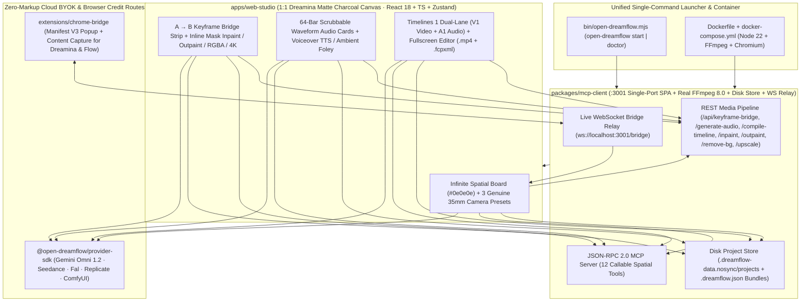

# Open-DreamFlow Studio

[](./LICENSE)
[](#3-zero-markup-byok-setup)
[](#4-mcp-server--local-ffmpeg-80-engine-3001)
[](#1-one-command-unified-launch-recommended)
[](#2-docker-one-command-launch)

**Open-DreamFlow** is a production-grade, MIT-licensed open-source spatial AI filmmaking workstation that combines **Dreamina 2.0 Smart Canvas** + **Google Flow (`gemini-omni-1.2-flash` 15s + Scene Builder)** with a **Zero-Markup BYOK + 12-Tool FFmpeg 8.0 MCP Engine + Live Browser Bridge** architecture.

Instead of paying 3×–8× SaaS credit markups or juggling disconnected tabs, filmmakers compose on a **95%-open `#0e0e0e` matte charcoal spatial canvas** stocked with **real 35mm camera photography presets**, cyan `#20D5EC` Bezier wire-drop menus, **True First-Frame → Last-Frame Keyframe Bridges (`A → B`)**, **64-Bar Interactive Waveform Audio & Voiceover TTS Nodes**, interactive **Inline Mask Inpainting / Outpainting / RGBA Cutout / 4K Lanczos Upscaling**, `@Elements` 6-reference identity vaults, 1-click **9-Grid Contact Sheet Slicing**, **Smart Multiframes (2–10 keyframes)**, disk project persistence (`.dreamflow.json` bundles), and an embedded **`Timelines 1` Dual-Lane (`V1 + A1`) Sequence Node** that mixes stereo audio into H.264/AAC `.mp4` masters and exports **Premiere Pro / Final Cut Pro `.fcpxml`**.

---

## System Architecture



---

## Dreamina 2.0 + Google Flow Feature Matrix

| Capability | Proprietary Inspiration | Open-DreamFlow Implementation |
| :--- | :--- | :--- |
| **1:1 Matte Spatial Canvas & 35mm Presets** | Dreamina 2.0 Canvas | 95%-open `#0e0e0e` board with `20px` dot matrix, `#191919`/`#252525` floating pills, drag-from-`(+)` Bezier wire-drop spawning, and 3 natural camera presets: **Salt & Terracotta — Coastal Short** (`35mm Kodak 250D`), **Kyoto Joinery — Craft Study** (`50mm Leica Summilux`), and **Alpine Pass — Architectural Monograph** (`24mm Wide Prime`). |
| **First-Frame → Last-Frame Keyframe Bridge (`A → B`)** | Dreamina Smart Frames + Flow Transitions | Wire two Image nodes into a Video node (or pick `[Frame A] ➔ [Curve] ➔ [Frame B]` in the contextual prompt bar) with **Ease In-Out**, **Linear**, **Match Dissolve**, or **Whip Pan** curves via `POST /api/keyframe-bridge` (cloud first/last-frame conditioning + local FFmpeg 60fps optical zoompan/blend synthesis). |
| **Interactive 64-Bar Waveform Audio & TTS** | Native Foley + Voiceover Studio | `360×150` `Audio` canvas cards with live HTML5 `<audio>` playback, click-to-scrub 64-bar `#20D5EC` amplitude waveforms computed via FFmpeg `astats`, macOS `say` / cloud TTS voiceovers, and stereo ambient soundscapes (`POST /api/generate-audio`). |
| **`Timelines 1` Dual-Lane (`V1 + A1`) Sequence** | Dreamina Canvas Timeline + Flow Scene Builder | Live `1120×196` sequence card on the canvas with `V1` video thumbnails + compact `A1` waveform strip, **Fullscreen Multi-Track Editor**, **Last-Frame Extractor** (`/api/extract-last-frame`), stereo H.264+AAC `.mp4` master muxing (`/api/compile-timeline`), and **FCPXML v1.10** (`.fcpxml`) export. |
| **Interactive Inline Frame Editor** | Dreamina Smart Inpaint & Expand | Live HTML5 `<canvas>` brush mask painting (`POST /api/inpaint` with cloud BYOK + FFmpeg `maskedmerge` regional synthesis) and aspect-ratio **Expand (Outpaint)** (`16:9`, `21:9`, `9:16`, `1:1` via `POST /api/outpaint`). |
| **1-Click RGBA Cutout & 4K Upscale** | Dreamina Remove BG & HD Upscale | `POST /api/remove-bg` isolates subjects onto transparent RGBA PNG nodes rendered over a dark matte checkerboard; `POST /api/upscale` renders crisp `3840px` 4K Lanczos + unsharp outputs. |
| **9-Grid Contact Sheet Slicer** | Dreamina Storyboard Grid | Synthesizes a 3×3 (or 2×2 **4-Angle Coverage**) photographic contact sheet and pixel-slices all panels via FFmpeg `crop` (`POST /api/slice-grid`) into linked spatial Shot Nodes in 1 click. |
| **`@Elements` & Cinema Kit** | Google Flow Ingredients / Style DNA | Lock up to 6 reference photographs (`@Clara_Vidal`, `@Leica_M6`, `@Limestone_Villa`) with inline `@` autocomplete, Cinema Kit optical locks (`Kodak Vision3 250D`, `Leica Summilux 35mm`), and interactive **3D Camera Director** azimuth/elevation/prime injection. |
| **Disk Persistence & `.dreamflow.json`** | Cloud Project Workspaces | Auto-saves graph edits (`800ms` debounce) to `.dreamflow-data.nosync/projects/<id>.json`, supports named **Version Snapshots** with 1-click restore, and exports/imports portable `.dreamflow.json` project bundles. |

---

## Monorepo Structure

```text
open-dreamflow/
├── bin/
│   └── open-dreamflow.mjs      # Unified CLI (`open-dreamflow start [--port 3001]` & `open-dreamflow doctor`)
├── apps/
│   └── web-studio/             # React 18 + TypeScript + Vite + Tailwind + Zustand 1:1 Dreamina UI
│       ├── public/media/       # Genuine camera EXIF JPEGs, organic 35mm H.264 MP4s & stereo foley MP3
│       └── src/
│           ├── components/     # CanvasBoard, DreaminaFloatingChrome, ContextualNodeOverlay,
│           │                   # InlineImageEditorModal, TimelineCanvasNode, ShareableAppView, ProviderModal
│           ├── presets/        # 3 natural photography presets (Salt & Terracotta, Kyoto Joinery, Alpine Pass)
│           ├── store/          # Zustand store + Disk Auto-Save + Snapshots + Keyframe Bridge + Audio/TTS
│           ├── services/       # Zero-Markup BYOK, dynamic :3001 REST/MCP client, WS bridge client
│           └── utils/          # FCPXML v1.10 exporter, warm Kodak 250D fallbacks, URL recipe codec
├── packages/
│   ├── provider-sdk/           # @open-dreamflow/provider-sdk (Gemini Omni 1.2, Seedance, Fal, Replicate, ComfyUI)
│   └── mcp-client/             # @open-dreamflow/mcp-client (:3001 Single-Port SPA + FFmpeg 8.0 + 12 MCP Tools)
├── extensions/
│   └── chrome-bridge/          # Manifest V3 Chrome Extension + Popup syncing Dreamina & Google Flow via WS/HTTP
├── Dockerfile                  # Production single-container image (Node 22 + FFmpeg)
└── docker-compose.yml          # One-command container orchestration with persistent project/media volume
```

---

## Quickstart

### 1. One-Command Unified Launch (Recommended)

Build once and launch the entire studio—Web Studio SPA, FFmpeg 8.0 media pipeline, 12-tool MCP server, disk project store, and WebSocket Chrome Bridge—on **one single port (`http://localhost:3001`)**:

```bash
cd open-dreamflow
npm install
npm run build

# Run environment diagnostics (Node, FFmpeg, ffprobe, TTS, built assets)
npx open-dreamflow doctor

# Launch unified single-port Open-DreamFlow Studio on http://localhost:3001
npx open-dreamflow start --port 3001 --no-open
```

Open **`http://localhost:3001`**. Everything works out of the box with zero API keys: switch between the 3 35mm camera presets (`Salt & Terracotta`, `Kyoto Joinery`, `Alpine Pass`), bridge keyframes (`A → B`), synthesize voiceovers or stereo foley with 64-bar waveforms, paint inpaint masks, slice 9-grid contact sheets, and compile `V1 + A1` `.mp4` masters.

---

### 2. Docker One-Command Launch

```bash
docker compose up --build
```

Then open **`http://localhost:3001`**. Projects and generated media persist cleanly in the mounted `.dreamflow-data.nosync` volume.

*(For Vite HMR frontend development, you can still run `node packages/mcp-client/dist/server-bridge.js --port 3001` alongside `cd apps/web-studio && npm run dev` on `:8789`—`executionRouter.ts` auto-detects both single-port `:3001` and split `:8789 → :3001` modes.)*

Run end-to-end verification tests across packages:

```bash
npm test
```

---

### 3. Zero-Markup BYOK Setup

Click **`BYOK · MCP`** in the top-right header (or click the model pill in the contextual prompt bar):

1. **Google AI Studio (`gemini-omni-1.2-flash`)**: Paste your `AIzaSy...` key for direct `POST /v1beta/interactions` calls (4–15s video, first/last-frame keyframe conditioning, up to 6 `@Element` refs, and `previous_interaction_id` multi-turn branching) plus Gemini image editing on `/api/inpaint`.
2. **BytePlus Ark (`seedream-3-0` / `seedance-1-0-pro`)**, **Fal.ai (`fal_...`)**, **Replicate (`r8_...`)**, or **Local ComfyUI (`http://127.0.0.1:8188`)**: Raw pass-through execution with **0% platform markup**.
3. Keys persist strictly in browser `localStorage` (`open_dreamflow_byok_v1`) and can be cleared in 1 click.

---

### 4. MCP Server & Local FFmpeg 8.0 Engine (`:3001`)

`packages/mcp-client` exposes **12 real JSON-RPC 2.0 MCP tools** at `http://localhost:3001/mcp` and `ws://localhost:3001/mcp`:

- `generate_video`, `keyframe_bridge`, `generate_audio`, `flow_scene_builder`
- `slice_contact_sheet`, `extract_last_frame`, `inpaint_frame`, `outpaint_expand`
- `remove_background`, `upscale_4k`, `extract_style_dna`, `save_project`

Any connected MCP tool can be spawned directly onto the spatial canvas as an executable node card from **`BYOK · MCP → MCP Servers (:3001)`**.

---

### 5. Chrome Extension Subscription Bridge (`ws://localhost:3001/bridge`)

Capture generated frames, videos, and prompts from **`dreamina.capcut.com`** and **`labs.google/fx/tools/flow`** (`flow.google.com`) directly onto your Open-DreamFlow canvas:

1. Open `chrome://extensions` in Chrome, Arc, or Brave, enable **Developer mode**, and **Load unpacked** → `open-dreamflow/extensions/chrome-bridge`.
2. Open the extension popup to verify `:3001` bridge health or click **Capture Active Tab Media**, or use the floating **`Send to Open-DreamFlow`** pill injected on Dreamina / Google Flow pages.
3. Events stream live over `ws://localhost:3001/bridge` (or click **`Test Bridge Capture`** inside the **`Browser Credit Bridge`** tab to spawn a live 35mm frame onto the canvas immediately).

---

## License

Released under the [MIT License](./LICENSE).
