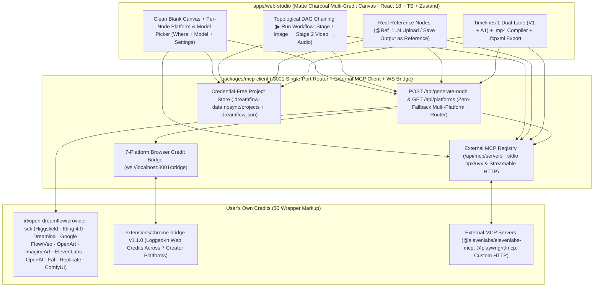

# Open-DreamFlow Studio

[](./LICENSE)
[](#3-connect-your-platform-credits-mcp--browser-bridge--api-keys)
[](#4-external-mcp-credit-routing--built-in-mcp-server)
[](#1-one-command-unified-launch-recommended)
[](#2-docker-one-command-launch)

**Open-DreamFlow** is an MIT-licensed, zero-markup multi-platform spatial canvas studio that unifies your existing AI creator credits—**Higgsfield, Sume (`sume.com`), Kling AI, Dreamina, Google Flow, OpenArt, ImagineArt, ElevenLabs, OpenAI, Fal.ai, Replicate, ComfyUI, and any MCP server**—into one node-based workflow without SaaS wrapper fees or credit markups.

Design reusable cross-platform pipelines on a **95%-open `#0e0e0e` matte charcoal spatial canvas**: generate a base frame with **ChatGPT Image 2.6 on Higgsfield**, wire that generated image directly into **Kling 4.0** for image-to-video motion, add **ElevenLabs Multilingual v2** voiceover or SFX, and share the workflow (`?recipe=` URL or `.dreamflow.json` bundle) so anyone can run it using **their own** MCP connections, logged-in browser credits, or API keys.

---

## System Architecture



---

## Multi-Platform Credit & Workflow Capabilities

| Capability | Supported Platforms & Models | How It Works on the Canvas |
| :--- | :--- | :--- |
| **Clean Blank Canvas & Honest Empty Nodes** | All 12 Platforms | Clicking **`+ New Blank Canvas`** starts 100% empty (`0` demo tags, `0` pre-filled stock shots). Spawning **Image**, **Video**, **Audio**, or **Reference (`@Element`)** creates a clean `idle` card with `[Where (Platform)] + [Model] + [Settings]`. |
| **Per-Node Platform, Model & DoP Rig** | **Higgsfield** (`ChatGPT Image 2.6`, `Soul`, `DoP I2V`), **Sume** (`ChatGPT Image`, `Flux Pro`, `Seedance 2.5`, `Kling 4.0`), **Kling AI** (`Kling 4.0`, `Kling 3.0 Master`), **Dreamina** (`Seedream 5.0 Pro`, `Seedance 2.5`), **Google Flow** (`Imagen 4`, `Nano Banana 2`, `Veo 3.1`), **OpenArt**, **ImagineArt**, **ElevenLabs**, **OpenAI**, **Fal**, **Replicate**, **ComfyUI** | Every node remembers its own `platformId`, `modelId`, aspect ratio (`16:9`, `9:16`, `1:1`, `4:3`, `3:4`, `21:9`), resolution (`1K`/`2K`/`4K`/`720p`/`1080p`), batch size (`1x`–`4x`), duration (`4s`–`15s`), **DoP Rig** camera motion (`Static Tripod`, `Slow Dolly In`, `Pull Back Reveal`, `Handheld 35mm`, `Crane Up`, `Orbit 180°`, `FPV Tracking`, `Anamorphic Rack Focus`), audio toggle, and voice ID. |
| **Cross-Platform Chaining (`Image → Video`)** | e.g. `Higgsfield · ChatGPT Image 2.6` → `Kling AI · Kling 4.0` | Drag from a generated (or `idle`) Image node's `(+)` handle and pick **Create Video**, or click **`▶ Run Workflow`** in the top bar. Stage 1 generates on Platform A and automatically passes its real output image as `referenceImages[0]` into Stage 2 on Platform B. |
| **Real Reference Creation (`@Ref_1`)** | Upload from disk or save any generated node | Upload product/character photos directly into a **Reference (`@Element`)** node, or click **`Save @Ref`** on any generated canvas frame to lock it as a reusable reference across downstream prompts and wires. |
| **1-Click Connected Creator Browser** | `higgsfield.ai`, `sume.com`, `app.klingai.com`, `dreamina.capcut.com`, `labs.google/fx/tools/flow`, `openart.ai`, `imagine.art`, `elevenlabs.io` | Click **`Launch Connected Creator Browser`** once (`POST /api/connections/launch-browser`) to open a pre-linked Creator Chrome profile where signing into your web accounts lights up green **`Connected via Browser`** status badges automatically (`GET /api/connections/status`). |
| **MCP Credit Routing (`stdio` & `http`)** | `@elevenlabs/elevenlabs-mcp`, `@playwright/mcp@latest`, `mcp-fal-server`, or any custom MCP server | Register external MCP servers via 1-click presets in **`Connections · Credits → MCP Servers`**. Discovered tools auto-bind to canvas platforms and execute with zero wrapper fees. |
| **Credential-Free Workflow Sharing** | `?recipe=` URL & `.dreamflow.json` | Exported workflows preserve every node's platform, model, settings, prompts, and wires while **never** serializing API keys—recipients plug in their own credits and click **Run Workflow**. |

---

## Quickstart

### 1. One-Command Unified Launch (Recommended)

```bash
cd open-dreamflow
npm install
npm run build

# Verify local environment (Node, FFmpeg, ffprobe, built SPA & packages)
npx open-dreamflow doctor

# Launch unified single-port Open-DreamFlow Studio on http://localhost:3001
npx open-dreamflow start --port 3001 --no-open
```

Open **`http://localhost:3001`**:
1. Open the top-left project menu and click **`+ New Blank Canvas`** (or load **`Workflow Blueprint · Multi-Credit`** for a pre-wired `Higgsfield ChatGPT 2.6 → Kling 4.0 → ElevenLabs` graph).
2. Click **`Connections · Credits`** in the top-right header to connect an MCP server, Browser Credit Bridge tab, or direct API key.
3. Select any node, pick **Where** (platform) + **Model** + **Settings**, type your prompt, and click **Generate** (or **`▶ Run Workflow`** to run the full connected graph).

---

### 2. Docker One-Command Launch

```bash
docker compose up --build
```

Open **`http://localhost:3001`**. Projects and generated media persist in `.dreamflow-data.nosync`.

Run the automated end-to-end verification suite across all packages:

```bash
npm test
```

---

### 3. Connect Your Platform Credits (MCP · Browser Bridge · API Keys)

Click **`Connections · Credits`** in the top-right header for the **MCP-First Guided Hub** with unmistakable company brand icons (`PlatformBrandIcon`) and an animated 4-stage connection progress stepper:

- **#1 Featured — Higgsfield Official MCP (`https://mcp.higgsfield.ai/mcp` · OAuth 2.1 + PKCE):**
  Click **`Connect Higgsfield via MCP →`** to complete browser OAuth with live progress + emerald checkmark confirmation, then use the built-in **MCP Functions & Info Explorer** to check GPU/account status, run any MCP tool with auto-generated forms, or drop functions straight onto the canvas. Also supports **`npx -y @higgsfield/cli mcp`**, **Console Key ID + Secret (`console.higgsfield.ai`)**, and CDP-verified browser sign-in.
- **All 13 Creator Platforms — MCP + Browser Check + `$0 Markup` APIs:**
  Connect **ElevenLabs Official MCP (`@elevenlabs/elevenlabs-mcp`)**, **Sume**, **Kling AI**, **Dreamina**, **Google Flow**, **OpenArt**, **ImagineArt**, **OpenAI**, **Fal.ai**, **Replicate**, **ComfyUI**, or any **Custom Streamable HTTP / Stdio MCP**. Includes explicit **`↻ Verify Browser Sign-In`** (`POST /api/connections/check-browser`) and collapsible Chrome Extension (`open-dreamflow/extensions/chrome-bridge`) manual setup.

---

### 4. External MCP Credit Routing & Built-In MCP Server

`packages/mcp-client` acts as **both**:
1. **An External MCP Client Host (`/api/mcp/servers` & `/api/mcp/call`)** capable of spawning local `stdio` MCP servers (`npx`, `uvx`, `node`, `python`) and connecting to remote JSON-RPC / Streamable HTTP MCP endpoints.
2. **A 14-Tool JSON-RPC 2.0 MCP Server (`http://localhost:3001/mcp`)** exposing `generate_node`, `list_platforms`, `generate_video`, `keyframe_bridge`, `generate_audio`, `flow_scene_builder`, `slice_contact_sheet`, `extract_last_frame`, `inpaint_frame`, `outpaint_expand`, `remove_background`, `upscale_4k`, `extract_style_dna`, and `save_project`.

---

## License

Released under the [MIT License](./LICENSE).
