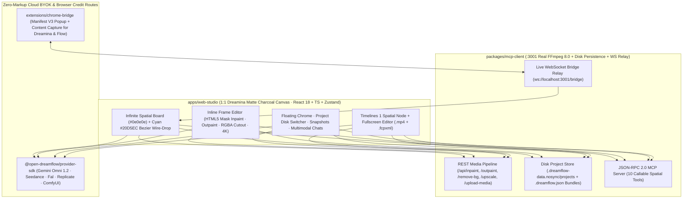

# Open-DreamFlow Studio

[](./LICENSE)
[](#zero-markup-byok-setup)
[](#mcp-server--local-ffmpeg-80-engine-3001)
[](#chrome-extension-subscription-bridge-wslocalhost3001bridge)

**Open-DreamFlow** is a production-grade, MIT-licensed open-source spatial AI filmmaking workstation that clones **Dreamina 2.0 Smart Canvas** + **Google Flow (`gemini-omni-1.2-flash` 15s + Scene Builder)** with a **Zero-Markup BYOK + 10-Tool FFmpeg 8.0 MCP Engine + Live Browser Bridge** architecture.

Instead of paying 3×–8× SaaS credit markups or juggling disconnected tabs, creators compose on a **95%-open `#0e0e0e` matte charcoal spatial canvas** with cyan `#20D5EC` Bezier wire-drop menus, interactive **Inline Mask Inpainting / Outpainting / RGBA Cutout / 4K Lanczos Upscaling**, `@Elements` 6-reference identity vaults, 1-click **9-Grid Contact Sheet Slicing**, **Smart Multiframes (2–10 keyframes)**, real disk project persistence (`.dreamflow.json` archives), and an embedded **`Timelines 1` Spatial Sequence Node** that compiles H.264 `.mp4` masters and exports **Premiere Pro / Final Cut Pro `.fcpxml`**.

---

## System Architecture



---

## Dreamina 2.0 + Google Flow Feature Matrix

| Capability | Proprietary Inspiration | Open-DreamFlow Implementation |
| :--- | :--- | :--- |
| **1:1 Matte Spatial Canvas** | Dreamina 2.0 Canvas | 95%-open `#0e0e0e` board with `20px` dot matrix, `#191919`/`#252525` floating glass pills, right-click canvas/node menus, and drag-from-`(+)` port Bezier wire-drop node spawning (`CanvasBoard.tsx`). |
| **Interactive Inline Frame Editor** | Dreamina Smart Inpaint & Expand | Live HTML5 `<canvas>` brush mask painting (`POST /api/inpaint` with cloud BYOK + FFmpeg `maskedmerge` regional synthesis) and aspect-ratio **Expand (Outpaint)** (`16:9`, `21:9`, `9:16`, `1:1` via `POST /api/outpaint`) (`InlineImageEditorModal.tsx`). |
| **1-Click RGBA Cutout & 4K Upscale** | Dreamina Remove BG & HD Upscale | `POST /api/remove-bg` isolates subjects onto transparent RGBA PNG nodes rendered over a dark matte checkerboard; `POST /api/upscale` renders crisp `3840px` 4K Lanczos + unsharp outputs. |
| **9-Grid Contact Sheet Slicer** | Dreamina Storyboard Grid | Synthesizes a 3×3 (or 2×2 **4-Angle Coverage**) contact sheet and pixel-slices all panels via FFmpeg `crop` (`POST /api/slice-grid`) into linked spatial Shot Nodes in 1 click. |
| **Disk Persistence & `.dreamflow.json`** | Cloud Project Workspaces | Auto-saves graph edits (`800ms` debounce) to `.dreamflow-data.nosync/projects/<id>.json`, supports named **Version Snapshots** with 1-click restore, and exports/imports portable `.dreamflow.json` project bundles. |
| **`@Elements` & Cinema Kit** | Google Flow Ingredients / Style DNA | Lock up to 6 reference images (`@Hero_Kael`, `@Cyber_Sneaker`, `@Brand_Style`) with inline `@` autocomplete, Cinema Kit optical locks, and interactive **3D Camera Director** azimuth/pitch/FOV injection. |
| **Multimodal Director `Chats`** | Dreamina Agent Chat | Bottom-right `Chats` drawer with quick-action sequence builders (`+ 3-Shot Sequence`, `Branch Multi-Turn Remix`, `Slice Active Sheet`, `Compile Master .mp4`), inline `<video>` previews, and clickable node-focus pills. |
| **`Timelines 1` Spatial Sequence Node** | Dreamina Canvas Timeline + Flow Scene Builder | Live sequence card directly on the canvas with `00:00 / 00:15` transport, clip strip, **Fullscreen Multi-Track Editor**, **Last-Frame Extractor** (`/api/extract-last-frame`), H.264 `.mp4` concat (`/api/compile-timeline`), and **FCPXML v1.10** (`.fcpxml`) export. |

---

## Monorepo Structure

```text
open-dreamflow/
├── apps/
│   └── web-studio/             # React 18 + TypeScript + Vite + Tailwind + Zustand 1:1 Dreamina UI (:8789)
│       └── src/
│           ├── components/     # CanvasBoard, DreaminaFloatingChrome, ContextualNodeOverlay,
│           │                   # InlineImageEditorModal, TimelineCanvasNode, ShareableAppView, ProviderModal
│           ├── store/          # Zustand store + Disk Auto-Save + Snapshots + Director Chat + Undo/Redo
│           ├── services/       # Zero-Markup BYOK, :3001 REST/MCP client, ws://localhost:3001/bridge client
│           └── utils/          # FCPXML v1.10 exporter, procedural fallback synthesizer, URL recipe codec
├── packages/
│   ├── provider-sdk/           # @open-dreamflow/provider-sdk (Gemini Omni 1.2, Seedance, Fal, Replicate, ComfyUI)
│   └── mcp-client/             # @open-dreamflow/mcp-client (:3001 FFmpeg 8.0 Media Server + 10-Tool MCP + WS Relay)
└── extensions/
    └── chrome-bridge/          # Manifest V3 Chrome Extension + Popup syncing Dreamina & Google Flow via WS/HTTP
```

---

## Quickstart

### 1. Launch Full Studio Stack (`:3001` Media/MCP Engine + `:8789` Web Studio)

```bash
cd open-dreamflow
npm install
npm run build

# Terminal 1: Start the FFmpeg 8.0 Media, Disk Project & MCP/WS Bridge Server (:3001)
node packages/mcp-client/dist/server-bridge.js --port 3001

# Terminal 2: Start Web Studio (:8789)
cd apps/web-studio && npm run dev
```

Open **`http://localhost:8789`**. Web Studio automatically connects to `http://localhost:3001` and `ws://localhost:3001/bridge`, loads saved projects from `.dreamflow-data.nosync/projects/`, and lets you run **Mask Inpainting**, **Outpainting**, **Remove BG**, **4K Upscale**, **9-Grid Contact Sheet Slicing**, **Device Media Uploads**, and **H.264 `.mp4` Timeline Compilation** out of the box with zero API keys.

Run end-to-end verification tests across packages:

```bash
npm test
```

---

### 2. Zero-Markup BYOK Setup

Open the top-right **`…` → `BYOK, MCP & Bridge Settings`** modal (or click the model pill in the contextual prompt bar):

1. **Google AI Studio (`gemini-omni-1.2-flash`)**: Paste your `AIzaSy...` key for direct `POST /v1beta/interactions` calls (4–15s video, up to 6 `@Element` refs, and `previous_interaction_id` multi-turn branching) plus Gemini image editing on `/api/inpaint`.
2. **BytePlus Ark (`seedream-3-0` / `seedance-1-0-pro`)**, **Fal.ai (`fal_...`)**, **Replicate (`r8_...`)**, or **Local ComfyUI (`http://127.0.0.1:8188`)**: Raw pass-through execution with **0% platform markup**.
3. Keys persist strictly in browser `localStorage` (`open_dreamflow_byok_v1`) and can be cleared in 1 click.

---

### 3. MCP Server & Local FFmpeg 8.0 Engine (`:3001`)

`packages/mcp-client` exposes **10 real JSON-RPC 2.0 MCP tools** at `http://localhost:3001/mcp` and `ws://localhost:3001/mcp`:

- `generate_video`, `slice_contact_sheet`, `extract_last_frame`, `flow_scene_builder`
- `inpaint_frame`, `outpaint_expand`, `remove_background`, `upscale_4k`
- `extract_style_dna`, `save_project`

Any connected MCP tool can be spawned directly onto the spatial canvas as an executable node card from **`MCP Servers (:3001)`**.

---

### 4. Chrome Extension Subscription Bridge (`ws://localhost:3001/bridge`)

Capture generated frames, videos, and prompts from **`dreamina.capcut.com`** and **`labs.google/fx/tools/flow`** (`flow.google.com`) directly onto your Open-DreamFlow canvas:

1. Open `chrome://extensions` in Chrome, Arc, or Brave, enable **Developer mode**, and **Load unpacked** → `open-dreamflow/extensions/chrome-bridge`.
2. Open the extension popup to check `:3001` bridge health or click **Capture Active Tab Media**, or use the floating **`Send to Open-DreamFlow`** pill injected on Dreamina / Google Flow pages.
3. Events stream live over `ws://localhost:3001/bridge` (or click **`Test Bridge Capture`** inside the **`Browser Credit Bridge`** tab to test live node spawning immediately).

---

## License

Released under the [MIT License](./LICENSE).
