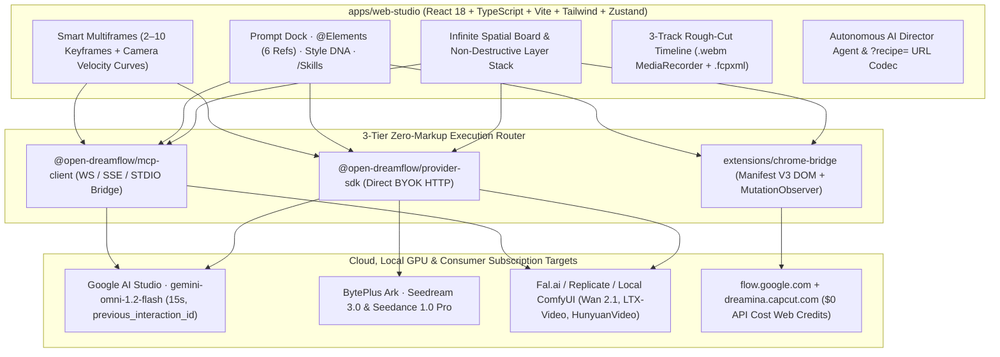

# Open-DreamFlow Studio

[](./LICENSE)
[](#zero-markup-byok-setup)
[](#mcp-server-bridge-setup)
[](#chrome-extension-subscription-bridge)

**Open-DreamFlow** is a production-grade, MIT-licensed open-source spatial AI filmmaking workstation that reverse-engineers and unifies **Dreamina 2.0 Smart Canvas** + **Google Flow (`gemini-omni-1.2-flash` 15s + Scene Builder)** with a **Zero-Markup BYOK + Model Context Protocol (MCP) + Browser Subscription Credits** architecture.

Instead of paying 3×–8× SaaS credit markups or juggling disconnected tabs, creators compose on a frameless dark infinite canvas with non-destructive layers, `@Elements` 6-reference identity vaults, 1-click **9-Grid Contact Sheet Slicing**, **Smart Multiframes (2–10 keyframes)**, stateful multi-turn video branching (`previous_interaction_id`), and a docked 3-track rough-cut timeline that compiles `.webm` masters and exports **Premiere Pro / Final Cut Pro `.fcpxml`**.

---

## System Architecture



---

## Dreamina 2.0 + Google Flow Feature Matrix

| Capability | Proprietary Inspiration | Open-DreamFlow Implementation |
| :--- | :--- | :--- |
| **Infinite Spatial Canvas** | Dreamina 2.0 Canvas | Frameless dark obsidian board (`#07080C`), cursor-centered zoom, snap grid, Shift+drag marquee multi-select, and animated port-to-port Bezier connections (`CanvasBoard.tsx`). |
| **Interactive Brush Inpaint** | Dreamina Smart Inpaint | Live HTML5 `<canvas>` mask painting directly over any selected frame + regional prompt redraw stored non-destructively in the `Inpaint Mask` layer. |
| **Smart Expand (Outpaint)** | Dreamina Expand | 1-click boundary synthesis & aspect-ratio expansion (`16:9`, `21:9`, `9:16`, `1:1`) with feathered seam blending. |
| **Remove BG & Mini Layer Stack** | Dreamina Layer Split | Non-destructive 4-layer stack (`Foreground Subject`, `Background`, `Inpaint Mask`, `Text Overlay`) with true alpha subject isolation, per-layer eye toggles, and opacity sliders. |
| **9-Grid Contact Sheet Slicer** | Dreamina Storyboard Grid | Synthesizes a coherent 3×3 (or 2×2 **4-Angle Camera Coverage**) contact sheet and pixel-slices all 9 (or 4) panels into linked spatial Shot Nodes in 1 click. |
| **`@Elements` 6-Image Vaults** | Google Flow Ingredients / Dreamina Refs | Lock up to 6 orthographic/character/product reference images (`@Hero_Kael`, `@Cyber_Sneaker`, `@Brand_Style`) with inline `@` visual autocomplete (`PromptDock.tsx`). |
| **Style DNA Optical Lock** | Style Reference Nodes | Extracts 5-hex color LUT swatches, lighting rig, anamorphic lens profile, and film stock into a connectible `Style DNA` lock node. |
| **Dreamina `/` Skill Engine** | Dreamina Agent Skills | Categorized `/` slash commands (`/9-Grid Storyboard`, `/4-Angle Coverage`, `/Cinematic Long Take`, `/FPV Drone Walkthrough`, `/UGC Product Ad`, `/Multi-Turn Night Remix`) + auto-registered `/mcp:*` skills. |
| **Smart Multiframes (2–10 KFs)** | Dreamina Multiframes | Chain 2 to 10 keyframe cards with per-bridge duration (`3s`–`15s`), SVG camera velocity curves (`Dolly In`, `Orbit 180°`, `Crane Up`, `Whip Pan`), First/Last frame lock, and 10s context (`MultiframeChain.tsx`). |
| **15s Stateful Multi-Turn Video** | Google Flow Omni 1.2 Flash | `POST /v1beta/interactions` client with `previous_interaction_id` conversational video branching (`🌿 Multi-Turn`) preserving actor choreography while remixing lighting/camera. |
| **3-Track Timeline & NLE Export** | Google Flow Scene Builder | Docked `V1 Video` + `A1 Voice/Lip-Sync` + `A2 SFX/Native Audio` tracks, **Frame-Accurate Last-Frame Extractor** (`✂️ Last Frame → Next Shot`), in-browser `.webm` `MediaRecorder` compiler, and valid **FCPXML v1.10** (`.fcpxml`) export (`TimelineDock.tsx`). |

---

## Monorepo Structure

```text
open-dreamflow/
├── apps/
│   └── web-studio/             # React 18 + TypeScript + Vite + Tailwind + Zustand Studio UI
│       └── src/
│           ├── components/     # CanvasBoard, PromptDock, MultiframeChain, ProviderModal, TimelineDock
│           ├── store/          # Zustand store + Undo/Redo + ?recipe= URL codec + Director Agent
│           ├── services/       # Zero-Markup BYOK, MCP JSON-RPC/WS, Chrome Bridge router
│           └── utils/          # High-DPI Canvas Shot Synthesizer, 9-Grid Slicer, .webm & .fcpxml exporters
├── packages/
│   ├── provider-sdk/           # @open-dreamflow/provider-sdk (Gemini Omni 1.2, Seedance, Fal, Replicate, ComfyUI)
│   └── mcp-client/             # @open-dreamflow/mcp-client (Universal WS/HTTP/SSE Client + Local STDIO Bridge)
└── extensions/
    └── chrome-bridge/          # Manifest V3 Chrome Extension bridging flow.google.com & dreamina.capcut.com
```

---

## Quickstart

### 1. Launch Web Studio

```bash
cd open-dreamflow/apps/web-studio
npm install
npm run dev
```

Open **`http://localhost:8789`**. Out of the box, Open-DreamFlow boots with an interactive showcase graph and an instant `$0.00` local spatial synthesis engine so you can test **Inpainting**, **Outpainting**, **Remove BG & Layers**, **9-Grid Contact Sheet Slicing**, **Smart Multiframes**, **`.webm` compilation**, and **`.fcpxml` export** immediately with zero API keys.

For a production build:

```bash
cd open-dreamflow/apps/web-studio
npm run build
```

---

### 2. Zero-Markup BYOK Setup

Click **`BYOK · MCP`** in the top-right header to open the Execution Router Modal:

1. **Google AI Studio (`gemini-omni-1.2-flash`)**: Paste your `AIzaSy...` key. Calls go directly from your browser to `https://generativelanguage.googleapis.com/v1beta/interactions` with up to 6 `inline_data` reference images, First/Last frame hints, 3–15s duration, and `previous_interaction_id` multi-turn branching.
2. **BytePlus Ark (`seedream-3-0` / `seedance-1-0-pro`)**: Direct multi-keyframe & 9-grid synthesis.
3. **Fal.ai / Replicate / OpenAI / Local ComfyUI (`http://127.0.0.1:8188`)**: Run open-weight Wan 2.1, LTX-Video, HunyuanVideo, or Flux locally or on raw cloud billing with **$0 middleman markup**.
4. All credentials live strictly in your browser's `localStorage` (`open_dreamflow_byok_v1`) and can be wiped in 1 click.

---

### 3. MCP Server Bridge Setup (`ws://localhost:3001/mcp`)

Expose local STDIO or HTTP Model Context Protocol servers (`flow-mcp`, `comfy-mcp`, custom tools) directly onto the Spatial Canvas:

```bash
# Start the built-in zero-dependency HTTP + WebSocket MCP Bridge
node packages/mcp-client/dist/server-bridge.js --port 3001
```

Then in Web Studio:
1. Open **`BYOK · MCP` → `2. MCP Server Manager`**.
2. Connect `ws://localhost:3001/mcp` (or `http://localhost:3001/mcp`).
3. Click **`Ping tools/list`** — discovered tools (`generate_video`, `inpaint_frame`, `extract_style_dna`, `flow_scene_builder`) automatically register as **`+ Canvas Node`** cards and `/mcp:*` slash skills!

---

### 4. Chrome Extension Subscription Bridge (`$0 API Cost`)

Spend your existing consumer subscription credits on **`flow.google.com`** (Google AI Pro/Ultra) and **`dreamina.capcut.com`** directly from the Open-DreamFlow canvas:

1. Open `chrome://extensions` in Chrome, Arc, or Brave and enable **Developer mode**.
2. Click **Load unpacked** and select `open-dreamflow/extensions/chrome-bridge`.
3. Open a logged-in tab to `https://flow.google.com` and/or `https://dreamina.capcut.com`.
4. In Web Studio, open **`BYOK · MCP` → `3. Chrome Extension Bridge`** and click **`Ping Extension`**. Select either Chrome Bridge target as your active route to queue prompts, inject `@Element` references, and stream rendered `<video>` URLs back onto the spatial board via `MutationObserver`.

---

## URL Recipe Sharing & NLE Export

- **Share `?recipe=` Scene Graph**: Click **`Share ?recipe=`** in the top bar to encode your spatial nodes, Bezier connections, Style DNA locks, and Multiframe chain into a compact URL parameter anyone can open.
- **In-Browser `.webm` Master**: Click **`Compile .webm`** in the Timeline Dock to record a real 720p30 VP9/Opus `.webm` video mixing V1 shots with synthesized A1/A2 audio cues.
- **Premiere Pro / Final Cut Pro / DaVinci Resolve**: Click **`Export .fcpxml`** to download a standards-compliant FCPXML v1.10 timeline preserving V1 spine clips, dialogue lane `-1`, and SFX lane `-2`.

---

## License

Released under the [MIT License](./LICENSE).
