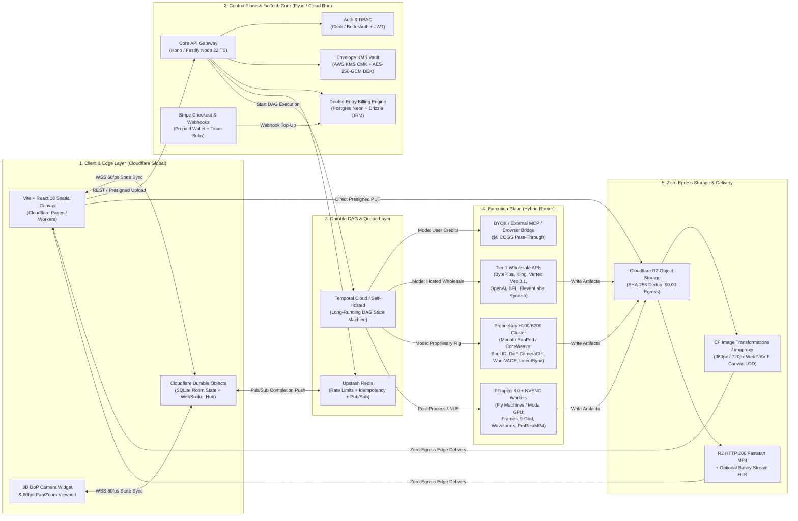
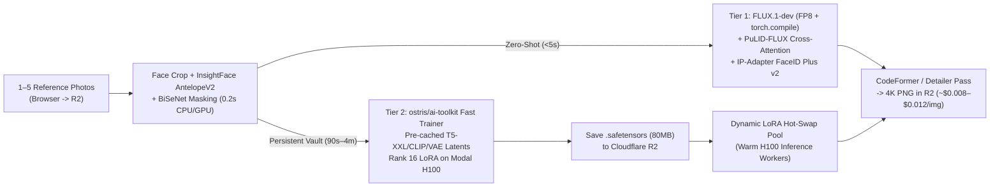

# Open-DreamFlow Commercial Scale Infrastructure, Wholesale API & Unit Economics Blueprint

**Author:** Principal Cloud, GPU, Media Hosting & FinTech Infrastructure Architect (`@infra`)  
**Target Platform:** Open-DreamFlow Commercial Cloud + MIT Self-Hosted Core (`open-dreamflow`)  
**Competitive Targets:** **Higgsfield.ai** (`higgsfield.ai` / `cloud.higgsfield.ai`) & **Sume.com** (`sume.com`)  
**Baseline Codebase Anchors:** [`packages/provider-sdk/src/index.ts`](../packages/provider-sdk/src/index.ts), [`packages/provider-sdk/src/platforms.ts`](../packages/provider-sdk/src/platforms.ts), [`packages/mcp-client/src/server-bridge.ts`](../packages/mcp-client/src/server-bridge.ts), [`apps/web-studio/src/types/studio.ts`](../apps/web-studio/src/types/studio.ts)  
**Companion Architecture & Design Boards:** [`docs/figma-design-links.md`](./figma-design-links.md) (FigJam Cloud/GPU Architecture + Make UI Teardown Prototype)

---

## Executive Summary: "De-Wrapping" Higgsfield.ai & Sume.com

Both **Higgsfield.ai** and **Sume.com** are commercial orchestration wrappers layered on top of third-party foundation APIs (`Kling`, `Seedance`, `Veo`, `FLUX`, `GPT-Image`, `Wan`, `MiniMax`) plus targeted media infrastructure:

| Dimension | **Higgsfield.ai** | **Sume.com** | **Open-DreamFlow (Scale Edition)** |
| :--- | :--- | :--- | :--- |
| **Core UX** | Modular feature silos (Soul ID, DoP Cinema Studio, Genjutsu, Canvas) | Flat single-turn form + Agent + REST router | **95%-open spatial DAG canvas** (`Image -> Video -> Audio -> NLE Timeline`) |
| **Pricing Trap / Model** | Expiring monthly subs (`$19` Starter / `$59` Plus / `$129` Ultra) + separate `cloud.higgsfield.ai` pay-as-you-go (`$0.0032+`/img, `$0.042–$0.20+`/sec) | Non-expiring (365-day) `$5` prepaid wallet; `0%` markup on standard direct routes (`1.25x` on Video Router) | **Dual-Engine:** `$0`-COGS **BYOK / MCP / Browser Bridge** + **Hosted Instant `$5+` Wallet** (matches retail list via wholesale volume + proprietary GPU margin) |
| **Proprietary Moat** | **Soul ID** (face consistency) + **DoP Camera Rig** + **Genjutsu** (motion/object swap) | None (pure API aggregator + avatar endpoint) | **Open-weight Soul ID (`FLUX.1-dev` + PuLID + fast LoRA) + 3D DoP Rig (`Wan 2.2/2.6` + CameraCtrl + VACE)** running on serverless H100s |
| **Media & Storage Risk** | High video hosting burn subsidized by expiring credit breakage | Thin SaaS margin; exposed if storage/egress isn't zero-egress | **Cloudflare R2 (`$0.00` egress)** + Edge LOD image proxies + HTTP `206` faststart MP4s |
| **Extensibility** | Closed SaaS | Closed SaaS + Bearer API | **MIT Open Core + 14-Tool MCP Server + External `stdio`/HTTP MCP Host** |

### The Commercial Winning Wedge
1. **Zero-CAC Acquisition Funnel (`$0` Compute Cost to Us):** Creators already paying for Dreamina, Kling, Google Flow, ElevenLabs, or Higgsfield plug them in via our existing [`PLATFORM_CATALOG`](../packages/provider-sdk/src/platforms.ts) (`BYOK`, External MCP, or Chrome Bridge). Our COGS is `$0.00`.
2. **Instant Frictionless Monetization (Hosted Prepaid Wallet):** Creators without enterprise API keys click **Top Up `$10` (or `$5` Trial)** via Stripe. Behind the scenes, we route to **Tier-1 wholesale contracts** (`15–35%` negotiated volume discounts below public list prices) and our **self-hosted H100/B200 GPU endpoints** (`50–70%` gross margin), earning **15–25%+ blended gross margin** while charging list or lower prices than Sume/Higgsfield.
3. **Workflow Lock-In Without Credit Hostage-Taking:** Instead of trapping users with expiring monthly credits, we lock in studios with **multiplayer spatial DAGs**, **portable Character Soul LoRAs**, **3D DoP Camera Rigs**, and **non-destructive NLE Timelines**.

---

## 1. Full-Stack Reference Architecture

### 1.1 End-to-End System Topology



### 1.2 Request Lifecycle: Multi-Node DAG Execution (`ChatGPT Image -> Kling 4.0 -> ElevenLabs -> LipSync -> FFmpeg Master`)

Migrating Open-DreamFlow's current local topological runner (`runWorkflowPipeline` + `packages/mcp-client/src/server-bridge.ts`) to production scale follows a deterministic, zero-data-loss lifecycle:

1. **Instant Presigned Asset Ingestion (`<50ms`):** User drops a character photo onto a Reference (`@Element`) node. Browser hashes bytes via WebCrypto (`SHA-256`), checks `POST /v1/assets/dedup` (`200` if already in R2 -> instant zero-upload link!), or receives a 15-minute presigned R2 `PUT` URL to upload directly from browser to edge storage without touching our API servers' RAM.
2. **DAG Submission & Credit `HOLD` (`<30ms`):** User clicks **`Run Workflow`**. `Hono/Fastify` validates the topological DAG, computes worst-case estimated cost in microcents (`1 USD = 1,000,000 microcents`), executes an atomic Postgres `HOLD` transaction (`credit_ledger_entries`), and starts a **Temporal Workflow** (`workflowId: dag_<uuid>`).
3. **Wave 1 Execution (`ChatGPT Image 2.6` or `Soul ID`):**
   - Temporal Activity dispatches the request with an `idempotencyKey`.
   - For external APIs (`OpenAI`, `BytePlus`, `Kling`, `Vertex`), the activity returns immediately after webhook registration or uses an async **Temporal Activity Heartbeat / External Completion Token (`taskToken`)** so **zero worker compute is wasted sleeping** during 60–180 second renders!
   - When the provider webhook lands (or our Modal GPU callback fires), the worker streams the resulting PNG straight into R2 (`sha256/<prefix>/<hash>.png`), triggers `360px`/`720px` WebP thumbnail pre-warming, writes `media_assets`, and completes the Temporal Activity.
4. **Instant Canvas Feedback (`<50ms`):** The Temporal Activity publishes `{ dagId, nodeId, status: 'ready', assetUrls }` to Redis -> Cloudflare Durable Object -> pushes delta over WebSocket directly to every multiplayer client watching that canvas.
5. **Wave 2–4 Chaining (`Kling 4.0` + `ElevenLabs` -> `LipSync` -> `FFmpeg NVENC Master`):**
   - Temporal passes Wave 1's R2 signed read URL (plus any `[R|t]` camera matrix or `Soul` LoRA key) directly into `Kling 4.0` and runs `ElevenLabs` voiceover in parallel (DAG fan-out!).
   - Once both finish (DAG fan-in), `Sync.so` or self-hosted `LatentSync` merges video + voiceover, followed by `FFmpeg 8.0 NVENC` concatenating `V1 + A1` into a `faststart` MP4 master.
6. **Settlement (`CAPTURE` / `RELEASE`):** Temporal's final settlement step commits the **actual** measured provider cost (`CAPTURE`) and immediately `RELEASE`s any unused `HOLD` delta back to the user's wallet—or performs a full `RELEASE` if an upstream step fails permanently after retries.

### 1.3 Stack Choices & 2026 Pricing Benchmarks

| Layer | Recommended Vendor / Stack | Verified 2026 Pricing | Why This Choice Beats Alternatives |
| :--- | :--- | :--- | :--- |
| **Frontend Edge** | **Cloudflare Pages / Workers** (Vite + React 18 SPA) | `$0` Free (`100K` req/day); **`$5/mo`** Paid (`10M` reqs + `30M` CPU ms, `$0.30/M` overage, **`$0` static egress**) | Zero cold starts, native proximity to R2 & Durable Objects, zero bandwidth tax on heavy JS/WebGL bundles. |
| **Multiplayer Canvas Sync** | **Cloudflare Durable Objects** (SQLite-backed) / PartyKit | Included in `$5/mo` Workers Paid; **`$0.15/M` reqs**; **`$12.50/M` GB-sec** duration (`~$0.20/GB-hr`) | Single-threaded per-board actor eliminates Redis Pub/Sub lock races; supports 60fps cursor/node CRDTs + hibernation (`$0` when nobody has the tab open). |
| **API Gateway** | **Hono / Fastify (Node 22 TS)** on **Fly.io** (or Cloud Run) | Fly compute: **`$6/GB RAM/mo`** (`shared-cpu-1x 256MB` `~$2.19/mo`); egress **`$0.02/GB`** NA/EU | Direct code-reuse path from existing TypeScript engine in [`packages/mcp-client`](../packages/mcp-client/src/server-bridge.ts) and [`packages/provider-sdk`](../packages/provider-sdk/src/index.ts). |
| **Durable DAG Orchestrator** | **Temporal Cloud** (or Self-Hosted Temporal) vs **Trigger.dev v3** | **Temporal Cloud:** `$0` base fee, **`$50/M` actions** (first 5M; `$25/M` volume), **`$0.042/GB-hr`** active storage.<br>**Trigger.dev v3:** `$0` Free / `$10` Hobby / **`$50/mo` Pro** (`200+` concurrency, `$0.25/10K` runs + `$0.0000338/sec` Small 1x). | **MVP:** Start on **Trigger.dev v3 Pro (`$50/mo`)** or **BullMQ + Upstash Redis** (`$0.20/100K` commands) for fastest TS velocity.<br>**Scale (`>50K` jobs/mo):** Move to **Temporal** because `await condition()` waits 3+ minutes on Kling/Veo webhooks at zero CPU cost with deterministic replay across deploys. |

---

## 2. File Hosting, Media CDN, Video Streaming & Asset Pipeline

Video and high-res image platforms die by **egress fees**, not compute. Every 200-node spatial canvas triggers hundreds of asset fetches per pan/zoom session, and video renders (`5–30 MB` each) are re-watched, scrubbed, and forwarded across downstream nodes.

### 2.1 Object Storage: Why Cloudflare R2 Destroys AWS S3 Margins

| Metric | **Cloudflare R2** | **AWS S3 (`us-east-1`)** | Impact on Video AI Unit Economics |
| :--- | :--- | :--- | :--- |
| **Standard Storage** | **`$0.015 / GB-month`** (`10 GB` free) | `$0.023 / GB-month` (first 50 TB) | **35% cheaper** base storage |
| **Infrequent Access** | **`$0.010 / GB-month`** (30d min, `$0.01/GB` retrieval) | `$0.0125 / GB-month` (S3-IA) | Ideal for cold project archives (`>30d`) |
| **Write Ops (Class A)** | `$4.50 / 1M` (`1M` free/mo) | `$5.00 / 1M` (`PUT`/`LIST`) | 10% cheaper |
| **Read Ops (Class B)** | `$0.36 / 1M` (`10M` free/mo) | `$0.40 / 1M` (`GET`) | 10% cheaper |
| **Public Internet Egress** | **`$0.00 / GB` (FOREVER FREE)** | **`$0.090 / GB`** (first 10 TB)<br>`$0.085 / GB` (10–50 TB)<br>`$0.070 / GB` (50–150 TB)<br>`$0.050 / GB` (`>150 TB`) | **Existential difference** |

> **Worked Margin Destruction Example (10,000 Active Creators):**  
> Assume 10,000 creators generate/preview media consuming `5 GB` of outbound CDN/playback bandwidth each per month = **`50 TB / month` egress**.  
> - On **AWS S3** direct egress: `10 TB × $0.09 + 40 TB × $0.085` = **`$4,300/month`** (`$51,600/year`) pure egress tax! (Even behind CloudFront, origin + CDN transfer runs `$2,500–$4,250/mo`.)  
> - On **Cloudflare R2**: **`$0.00/month`** egress. Total R2 bill for `15 TB` stored + `50 TB` delivered = `~$225` storage + `~$25` ops = **`~$250/month`**.  
> **R2 saves `$4,050/month` (`94%` reduction) at 10K creators**, letting us fund Sume-competitive `$5` wallets without losing money on replays!

#### Content-Addressed Deduplication & Lifecycle Policy
- **Key Layout:** `s3://dreamflow-media/blobs/sha256/<b0..1>/<b2..3>/<full_sha256>.<ext>`
- **Zero-Duplicate Uploads:** Preset templates (`Salt & Terracotta`, `Workflow Blueprint`), shared stock textures, and identical downstream node outputs reference the same `media_assets.sha256` row (`ref_count++`) rather than duplicating multi-megabyte files per workspace fork.
- **R2 Lifecycle Rules:**
  1. `tmp/ephemeral/*` -> Auto-delete after **7 days** (intermediate ffmpeg slices, upload chunks).
  2. `blobs/*` (`last_accessed_at > 30 days`) -> Transition to **R2 Infrequent Access (`$0.01/GB-mo`)**; purge unreferenced soft-deleted assets after 90 days for free-tier users.

### 2.2 Image Optimization & 60fps Spatial Canvas LOD Proxy

Loading 200 raw `4K PNG` (`8–18 MB` each = `2+ GB` decoded GPU textures) onto an HTML/WebGL canvas crashes browser tabs. We decouple **Canvas Display LOD** from **Model Input Masters**:

| Tier | Format & Dimensions | Avg Size | Purpose | Cost Model |
| :--- | :--- | :--- | :--- | :--- |
| **LOD 0 (Canvas Zoom `<40%`)** | `360px` wide WebP (`q=78`) | `~18 KB` | Instant crisp thumbnails across 200-node zoomed-out DAGs | Edge-cached in Cloudflare CDN |
| **LOD 1 (Canvas Zoom `40–100%`)** | `720px` wide AVIF/WebP (`q=82`) | `~65 KB` | Crisp working card preview inside `CanvasBoard` | Edge-cached in Cloudflare CDN |
| **Master (Model Input / Export)** | Original `1K–4K PNG` / `16-bit EXR` | `2–18 MB` | Passed via short-lived R2 signed URL to Kling/Veo/FLUX/FFmpeg | Served directly from R2 (`$0` egress) |

#### Vendor Choice: Cloudflare Image Transformations vs Self-Hosted `imgproxy`
- **Phase 1–2 (`<500K` unique image renders/mo): Cloudflare Image Transformations on R2**
  - Pricing: **`5,000` unique transforms free/mo**, then **`$0.50 per 1,000` unique transforms**; **zero** per-image storage fee (`$5/100K` only applies to *Cloudflare Images* managed storage, NOT R2 external origin!) and **`$0` egress**.
  - Edge cache ensures 10,000 views of a `720px` node card count as **1** transformation (`$0.0005`).
- **Phase 3 (`>1M` unique transforms/mo): Self-Hosted `imgproxy` (`libvips`) on Fly.io**
  - Open-source `imgproxy` (MIT) runs on `2–4` shared/performance Fly Machines (`~$30–$120/mo`) behind Cloudflare CDN caching (`Cache-Control: public, max-age=31536000, immutable` on SHA-256 keys).
  - Eliminates the `$0.50/1K` transformation ceiling entirely (`~$0.05` per 1,000 transforms effective compute cost!).

### 2.3 Video Playback & Transcode Fleet

#### Playback Strategy Comparison (2026 Verified Rates)
| Option | Storage Cost | Delivery / Playback Cost | Encoding Cost | Verdict |
| :--- | :--- | :--- | :--- | :--- |
| **R2 Direct HTTP `206` Faststart MP4** *(Recommended Default)* | **`$0.015 / GB-mo`** | **`$0.00 / GB`** | Own FFmpeg worker (`~$0.0002/clip`) | **Unbeatable for AI clips (`5–15s`, `3–15 MB`).** Moving `moov` atom to front (`-movflags +faststart`) gives `<120ms` instant scrub & HTML5 `<video>` playback at **$0 streaming tax**. |
| **Bunny Stream** | `$0.010 / GB-mo` | `$0.01–$0.06 / GB` (regional) | **`$0.00` (Free HLS)** | **Best add-on for `>60s` NLE Timelines / public share galleries** needing adaptive HLS (`360p/720p/1080p`). |
| **Cloudflare Stream** | `$5.00 / 1,000 mins/mo` | `$1.00 / 1,000 mins` watched | **`$0.00` (Free)** | Great DX, but expensive for tiny short loops vs R2 (`1,000` 10s clips = 166 mins -> cheap at small scale, pricier than R2 at 100K creators). |
| **Mux Video** | `$0.0024 / min/mo` (720p) | `$0.0008 / min` (after 100K free) | `$0` Basic / `$0.025/min` Plus | Overkill for 5s generative nodes; reserve only if enterprise DRM/QoE analytics is sold. |

#### Containerized FFmpeg 8.0 + NVENC Worker Pool (`Modal` / `Fly Machines`)
Every local FFmpeg operation currently in [`packages/mcp-client/src/server-bridge.ts`](../packages/mcp-client/src/server-bridge.ts) moves into an autoscaling stateless microservice (Fly Machines CPU for audio/metadata; **Modal T4/L4 GPU (`~$0.59–$0.80/hr`, `$0.00016–$0.00022/sec`)** for hardware-accelerated `h264_nvenc` / `hevc_nvenc`):
1. **Ingest Normalization (`<1.2s`):** Probe via `ffprobe`, remux with `-movflags +faststart`, extract poster PNG + `480p` proxy MP4 for smooth timeline scrubbing.
2. **Last-Frame Extraction (`<0.4s`):** `ffmpeg -sseof -0.1 -i input.mp4 -frames:v 1` for instant `Video -> Image -> Next Video` chaining.
3. **Contact-Sheet Slicer (`<0.8s`):** Splits `3×3` / `2×2` grids (`slice_contact_sheet`) into 9 individual R2 SHA-256 assets in one parallel batch.
4. **64-Bar Waveform JSON (`<0.2s`):** Streams mono `1000 Hz` `f32le` PCM and returns normalized `[0.08..1.0]` RMS array stored directly in Postgres `media_assets.metadata` (no client audio decoding!).
5. **NLE Master Compile (`2–8s`):** Multi-track `V1 + A1` ducking (`sidechaincompress` / `amix`), LUT burn-in, and export to **H.264/AAC `.mp4`**, **Apple ProRes 422 HQ `.mov`**, or lightweight **`.fcpxml`** timeline XML.
6. **Post-Production Enhancement Nodes (`SDR -> HDR` + `FPS Boost`):** Dedicated Modal L4/H100 workers running **RIFE / TensorRT optical flow interpolation** (`24fps -> 60fps` FPS boost) and **ACES / `zscale` + `libplacebo` 10-bit HEVC HDR tone-mapping** (matching and beating Sume's `/videos` Edit tab inside composable canvas nodes).

---

## 3. Wholesale Foundation Model APIs & Proprietary GPU Cluster

### 3.1 Direct Tier-1 Wholesale Contracts & Endpoints (Zero-Middleman Routing)

Sume and Higgsfield mark up or bundle third-party APIs. To capture **15–35% wholesale volume margin** while offering creators parity or lower per-generation pricing, Open-DreamFlow connects **directly** to Tier-1 model owners:

| Provider & Contract Tier | Models Routed | Direct Production Endpoint | 2026 Verified List / Wholesale Rate | Technical / Deprecation Notes |
| :--- | :--- | :--- | :--- | :--- |
| **BytePlus ModelArk** *(ByteDance Global)* | `Seedream 5.0 Pro/Lite/Flash`, `Seedream 5.5`, `Seedance 2.5 / 2.5 Flash` | `https://ark.ap-southeast.bytepluses.com/api/v3` (`/images/generations`, `/contents/generations/tasks`) | **Seedream 5.0 Flash:** `$0.018/img`<br>**Seedream 5.0 Lite:** `$0.035/img`<br>**Seedream 5.0 Pro:** `$0.045` (`≤1.5K`) / `$0.090` (`>1.5K`)<br>**Seedance 2.5 Flash:** `$0.07/s` (480p) / `$0.152/s` (720p)<br>**Seedance 2.5 Std:** `~$0.103/s` (480p), `~$0.231/s` (720p), `~$0.569/s` (1080p) | Failed/moderated jobs are **$0 billed**. Negotiate Enterprise committed spend (`$5K+/mo`) for `15–25%` off ModelArk token rates. |
| **Kuaishou Kling Enterprise API** | `Kling 3.0`, `Kling 3.0 Omni`, `Kling 4.0` | `https://api.klingai.com/v1/videos/image2video` & `text2video` (HS256 JWT `AK/SK`) | **Prepaid Enterprise Packs:** `$700` (`5K` units) to `$7,560` (`60K` units = `~$0.126/unit`)<br>**Kling 3.0 Per-Sec:** `$0.084–$0.126/s` (720p), `$0.112–$0.168/s` (1080p), `$0.42/s` (4K) | Existing JWT signer implemented in [`kling.ts`](../packages/provider-sdk/src/providers/kling.ts). Note: direct native `Kling 4.0` bulk enterprise access requires explicit enterprise SKU whitelist. |
| **Google Cloud Vertex AI** | `Veo 3.1` (Lite/Fast/Quality), `Gemini 3.1 Flash Image` (Nano Banana) | `https://{region}-aiplatform.googleapis.com/v1/...:predictLongRunning` (or Gemini API v1beta) | **Veo 3.1 Video-Only:** Lite `$0.03–$0.05/s`; Fast `$0.08–$0.25/s`; Std `$0.20–$0.40/s`<br>**Veo 3.1 w/ Audio:** Lite `$0.05–$0.08/s`; Fast `$0.10–$0.30/s`; Std `$0.40–$0.60/s`<br>**Gemini 3.1 Flash Image:** `~$0.034–$0.067` (1K), `~$0.15` (4K) | **CRITICAL:** Standalone `Imagen 4` tiers migrated/unified under Gemini native image generation; use Vertex AI **Provisioned Throughput / CUDs** + GCP Startup Credits (`$100K–$200K`) to cut Veo COGS! |
| **OpenAI Direct** | `GPT-Image 2.5 / 2.6` *(migrating off `gpt-image-1.5`)* | `https://api.openai.com/v1/images/generations` & `/edits` | **Tokens:** `$5/1M` text in, `$8/1M` img in, `$30–$32/1M` img out (`~$0.009` low, `~$0.034` med, `~$0.133–$0.20` high) | **CRITICAL:** OpenAI sunset `sora-2` / Videos API and scheduled `gpt-image-1.5` deprecation for **Dec 1, 2026**—route OpenAI image nodes strictly to `GPT-Image 2.5/2.6` and route video elsewhere! |
| **Black Forest Labs (BFL) Direct** | `FLUX.1 Kontext [Pro]`, `FLUX.1 Kontext [Max]`, `FLUX Pro/Dev` | `https://api.bfl.ai/v1/flux-kontext-pro` & `-max` | **Kontext Pro:** `$0.04/img`<br>**Kontext Max:** `$0.08/img`<br>**FLUX Schnell/Klein:** `$0.003–$0.009/img` | Best-in-class instruction-based character/scene editing without training a LoRA; ideal complement to our self-hosted `FLUX.1-dev`. |
| **MiniMax / Hailuo Direct** | `Hailuo H3 / 2.3` (T2V, I2V, S2V) | `https://api.minimaxi.chat/v1/video_generation` | **`$0.08–$0.13 / sec`** (`~$0.28–$0.56` per 6–10s clip) | Highest gross-margin value video alternative (`3x` cheaper than Veo Std / Kling 4K) for budget/rapid draft mode. |
| **ElevenLabs Direct** | `Eleven Multilingual v2`, `Eleven Flash v2.5`, `Sound Effects v2` | `https://api.elevenlabs.io/v1/text-to-speech/{voice_id}` | **Flash v2.5:** `$0.04 / 1K chars` (`0.5` credits/char)<br>**Scale/Business:** `$299/mo` (1.8M) – `$990/mo` (6M credits = `~$0.165/1K` std, lower on Enterprise) | Already wrapped in [`elevenlabs.ts`](../packages/provider-sdk/src/providers/elevenlabs.ts). Enterprise DPA drops character cost another `30–40%`. |
| **Sync.so vs LatentSync** | `lipsync-2` / `sync-3` vs **Open-Weight `LatentSync`** | `https://api.sync.so/v2/generate` vs **Self-Hosted H100** | **Sync.so:** `$0.025/s` (`1.9`), `$0.04–$0.05/s` (`2`), `$0.067–$0.083/s` (`2-pro`), `$0.107–$0.133/s` (`sync-3` 4K)<br>**Self-Hosted LatentSync:** **`$0.00` license; `~$0.006–$0.015/s`** GPU compute! | Use **self-hosted `LatentSync` on Modal H100** as our default hosted LipSync (`>75%` margin!) and route `sync-3` only when 4K commercial dubbing is selected. |

---

### 3.2 Serverless & Dedicated GPU Cluster Pricing (2026 Verified)

To eliminate middleman markups on open-weight pipelines (**Soul ID**, **DoP Camera Rig**, **Genjutsu**, **LatentSync**, **FFmpeg NVENC**), we split compute into **Burst Serverless** (`Modal` / `RunPod Serverless`) and **Steady-State Reserved Nodes** (`CoreWeave` / `RunPod Pods`):

| GPU Provider | Billing Granularity | NVIDIA H100 (80GB) | NVIDIA H200 (141GB) | NVIDIA B200 (180GB) | Best Workload Fit |
| :--- | :--- | :--- | :--- | :--- | :--- |
| **Modal** | **Per-second** (scale-to-zero) | **`$3.95 / hr`** (`$0.001097/s`) | **`$4.54 / hr`** (`$0.001261/s`) | **`$6.25 / hr`** (`$0.001736/s`) | **MVP & Spiky Inference:** Soul ID PuLID, fast LoRA training (`ai-toolkit`), FFmpeg NVENC, LatentSync. Zero idle waste! |
| **RunPod** | Pods (hourly) / Serverless (per-sec) | Pods: `$1.99–$2.99/hr`<br>Serverless: `$4.55/hr` | `$3.59–$5.29 / hr` | `$5.98–$7.99 / hr` | **Low-Cost Overflow & Batch LoRA Training:** Unbeatable pod $/hr for async background training queues. |
| **Baseten** | **Per-minute** managed | `$6.50 / hr` (MIG 40GB `$3.75/hr`) | — | `$9.98 / hr` | **Managed Sub-Second TRT-LLM/Custom CUDA Kernels** (`<60s` Wan 2.2) if we outsource kernel ops at Series A. |
| **CoreWeave** | Hourly `8×` HGX Nodes / Reserved | `$6.16/GPU-hr` on-demand (`$49.24/node`), **Spot `~$2.46/GPU-hr`** | `$6.31/GPU-hr` on-demand (`$50.44/node`) | `$8.60/GPU-hr` on-demand (`$68.80/node`), **Spot `~$4.26/GPU-hr`** | **100K-Creator Baseline:** Multi-GPU FSDP/Sequence-Parallel **Wan 2.2/2.6 14B** & **HunyuanVideo** clusters on InfiniBand. |

---

### 3.3 Proprietary Recipe 1: "Soul ID" Engine (Reverse-Engineering Higgsfield Soul)

Higgsfield's **Soul / Soul ID** generates photorealistic editorial portraits of the exact same human persona across arbitrary outfits, lighting, and scenes. Under the hood, this is a **two-tier identity lock architecture** easily replicated in open weights:



#### Exact Engineering Spec & Unit Economics
1. **Tier 1 — Instant Zero-Shot Identity Lock (`<5–7s` latency, `~$0.006–$0.012` raw COGS):**
   - **Backbone:** `FLUX.1-dev` (FP8 quantized + `torch.compile(mode="max-autotune")` + FlashAttention-3). Base 20-step inference takes **`2.0–3.5s`** on H100; adding **PuLID-FLUX** (`InsightFace` 512-dim ArcFace embedding + EVA-CLIP structural features) + optional **InstantID** ControlNet landmarks runs in **`4.5–7.0s`** warm.
   - **Cold Start Prevention:** Use Modal **Memory Snapshots** + **R2 local NVMe model pre-bake** inside container image so cold spins take `<5s` rather than `45s` HF downloads.
   - **Cost Math:** `6s × $0.001097/s` (Modal H100) = **`$0.0066`** GPU cost + `$0.001` orchestration/restoration = **`~$0.008/image`** (vs Higgsfield `$0.04+`/credit-eq retail or `$0.0032` low-step Soul Cinema).
2. **Tier 2 — On-Demand "Character Soul" LoRA (`2–4 min` fast train, `~$0.13–$0.26` raw COGS):**
   - When a user clicks **"Create Character Soul"** with `5–15` photos (or 1 photo + synthetic multi-angle augmentation via `FLUX Kontext`!), spin up an ephemeral **`ostris/ai-toolkit`** job on a Modal/RunPod **H100 (80GB)**:
     - **Step A (`15s`):** Auto-caption via Qwen2.5-VL / Florence-2 + **pre-cache** T5-XXL, CLIP-L, and VAE latents to NVMe so training touches only the DiT transformer blocks.
     - **Step B (`90s–180s`):** Run `500–800` steps (`rank=16`, `alpha=16`, `batch_size=2`, `Prodigy` or `AdamW8bit`, BF16/FP8 mixed precision) using `torch.compile`.
     - **Step C (`5s`):** Upload `<soul_id>.safetensors` (`~65–120 MB`) to Cloudflare R2 and index `r2_lora_key` in Postgres `character_souls`.
   - **Cost Math:** `150s × $0.001097/s` (Modal H100) = **`$0.165`** (or **`$0.10–$0.18`** on RunPod H100/Spot) — whereas managed APIs (Fal/Replicate fast LoRA trainers) charge **`$2.00–$5.00` per LoRA!** We can offer free/included Soul creation on Pro or charge `$0.50` and retain a **`70%+` gross margin**.
   - **Hot-Swap Inference:** Warm H100 inference pods maintain a `LRU` memory cache of top active Soul `.safetensors` on local NVMe and fuse/unfuse LoRA adapters in **`<80ms`** per request (`diffusers` `load_lora_weights` / `ComfyUI` LoRA loader).

---

### 3.4 Proprietary Recipe 2: "DoP Camera Control & Genjutsu" Engine (Reverse-Engineering Higgsfield Cinema & V2V)

#### A. 6-DoF DoP Camera Control (`[R|t]` Extrinsics + Plücker Embeddings)
Our web studio already has a 3D Camera / DoP Rig widget concept (`camera-3d` tool in [`studio.ts`](../apps/web-studio/src/types/studio.ts)). Instead of merely appending `"slow dolly in"` text tokens (which closed APIs often ignore), our proprietary GPU video engine enforces true geometric trajectories:

1. **WebGL -> Matrix Export:** The browser 3D camera widget outputs a JSON array of $F$ frames (`81` frames @ 16/24fps): `{ intrinsics: K [3×3], extrinsics: [R|t] [3×4] }` for Dolly, Crane, Orbit 180°, Bullet-Time, FPV Drone, or Handheld jitter.
2. **Plücker Ray Conversion (Server Pre-Pass `<50ms`):** Convert `[R|t]` and `K` into dense per-pixel **6-channel Plücker embeddings** ($\mathbf{p} = [\mathbf{o} \times \mathbf{d}, \mathbf{d}]$ where $\mathbf{o}$ is camera origin and $\mathbf{d}$ is normalized ray direction per pixel).
3. **Diffusion Injection (`CameraCtrl` + `Wan 2.2/2.6 14B` / `HunyuanVideo` / `CogVideoX`):**
   - Inject multi-scale Plücker features into the temporal attention blocks of **Wan 2.2/2.6 14B (FP8)**.
   - **VRAM & Speed Profile on H100 (80GB):** Raw BF16 720p `Wan 14B` hits `65–80 GB` VRAM and takes `~280–300s` unoptimized. By deploying **FP8 quantized DiT weights (`~22–26 GB` VRAM)** + **FlashAttention-3** + **SageAttention / custom GEMM kernels** (or `4×` / `8×` H100 **Sequence Parallelism** for `2.5–2.6x` speedup), 5-second `720p` generation drops to **`45–65 seconds`** on single/multi-H100!
   - **Cost Math:** `55s × $0.001097/s` (Modal H100) = **`$0.060` per 5s 720p clip** (`$0.012/sec`) — **7× cheaper than Kling 3.0/4.0 (`$0.084–$0.168/s`) and 16× cheaper than Veo 3.1 Quality (`$0.20–$0.40/s`)!**

#### B. Genjutsu Engine (Motion Transfer, Recasting & Object Swap)
Higgsfield **Genjutsu** allows taking a reference real-world video (someone dancing, walking, unboxing a product) and replacing the actor or wardrobe/object while keeping camera motion and physics intact. Our open-weight stack implements this as a unified DAG pipeline:

1. **Video Analysis Pass (`~4–8s` on L4/H100):**
   - **Camera + Geometry:** **DepthCrafter** extracts temporally smooth, flicker-free monocular depth video sequences (`Z(x,y,t)`).
   - **Human Pose:** **DWPose / ViTPose** extracts skeletal + hand + facial landmarks per frame.
   - **Segmentation:** **SAM 2** tracks click-selected objects/wardrobe masks across all frames ($M(x,y,t)$).
2. **Unified Conditioning Pass (`Alibaba Wan-VACE` + `MotionClone`):**
   - **Wan-VACE (Video All-in-one Creation and Editing)** unifies Text ($T$), Reference Character/Product Image ($F$, optionally Soul ID locked), and Spatiotemporal Depth/Mask/Pose Sequences ($M$) via its **Video Condition Unit (VCU) + Context Adapter** in a **single** diffusion run—handling object replacement, wardrobe swap, motion transfer, and video inpainting without chaining brittle ControlNet hacks.
   - For pure motion-trajectory cloning without depth locks, **MotionClone** extracts temporal attention maps from the source video and injects them into the denoising loop.

---

## 4. Database, Auth, Security Vault & Double-Entry Billing / Credit Ledger

### 4.1 Postgres (`Neon` / `Supabase`) + Drizzle ORM Schema

We recommend **Neon Postgres** (`$0.106 / CU-hr` autoscaling compute with scale-to-zero + `$0.35 / GB-mo` storage + database branching per PR) paired with **Drizzle ORM**.

> **Financial Rule #1:** Never store user wallet balances as a mutable `UPDATE workspaces SET balance = balance - 10` column alone, and never use floating-point `NUMERIC`/`FLOAT`. All money lives in **`BIGINT` microcents (`$1.00 = 1,000,000 microcents`)** inside an **immutable append-only double-entry ledger**.

```typescript
// packages/db/src/schema.ts (Drizzle ORM — PostgreSQL)
import {
  pgTable, pgEnum, uuid, text, bigint, integer,
  boolean, timestamp, jsonb, uniqueIndex, index
} from 'drizzle-orm/pg-core';

export const ledgerEntryTypeEnum = pgEnum('ledger_entry_type', [
  'TOPUP_STRIPE',       // +Credit when Stripe checkout settles
  'PROMO_GRANT',        // +Credit welcome/referral grant (expirable if flagged)
  'JOB_HOLD',           // -Available / +Held when DAG node starts
  'JOB_CAPTURE',        // Finalize actual cost from Held -> Revenue/COGS
  'JOB_RELEASE',        // Refund unused Held delta (or 100% on job failure)
  'SUBSCRIPTION_FEE',   // Monthly Pro/Team SaaS fee
  'CHARGEBACK_LOCK'     // Dispute hold
]);

export const transportModeEnum = pgEnum('transport_mode', [
  'hosted_wallet', 'byok', 'external_mcp', 'browser_bridge', 'local_comfy'
]);

export const workspaces = pgTable('workspaces', {
  id: uuid('id').defaultRandom().primaryKey(),
  ownerUserId: text('owner_user_id').notNull(),
  name: text('name').notNull(),
  planTier: text('plan_tier').notNull().default('free'), // free | pro | studio | enterprise
  stripeCustomerId: text('stripe_customer_id').unique(),
  concurrencyLimit: integer('concurrency_limit').notNull().default(4),
  // Cached materialized balance maintained inside SERIALIZABLE ledger tx for O(1) reads
  availableMicrocents: bigint('available_microcents', { mode: 'bigint' }).notNull().default(0n),
  heldMicrocents: bigint('held_microcents', { mode: 'bigint' }).notNull().default(0n),
  autoReloadThresholdMicrocents: bigint('auto_reload_threshold_microcents', { mode: 'bigint' }),
  autoReloadAmountMicrocents: bigint('auto_reload_amount_microcents', { mode: 'bigint' }),
  createdAt: timestamp('created_at', { withTimezone: true }).defaultNow().notNull(),
});

export const canvasDags = pgTable('canvas_dags', {
  id: uuid('id').defaultRandom().primaryKey(),
  workspaceId: uuid('workspace_id').references(() => workspaces.id, { onDelete: 'cascade' }).notNull(),
  title: text('title').notNull(),
  durableObjectRoomId: text('durable_object_room_id').notNull().unique(),
  r2SnapshotKey: text('r2_snapshot_key'), // Large >500-node DAG JSON/Yjs binary snapshot in R2
  publicRecipeSlug: text('public_recipe_slug').unique(), // Credential-free ?recipe= sharing
  nodeCount: integer('node_count').notNull().default(0),
  updatedAt: timestamp('updated_at', { withTimezone: true }).defaultNow().notNull(),
});

export const mediaAssets = pgTable('media_assets', {
  id: uuid('id').defaultRandom().primaryKey(),
  workspaceId: uuid('workspace_id').references(() => workspaces.id, { onDelete: 'cascade' }).notNull(),
  sha256: text('sha256').notNull(),
  r2Key: text('r2_key').notNull(), // blobs/sha256/ab/cd/<hash>.<ext>
  mimeType: text('mime_type').notNull(),
  byteSize: bigint('byte_size', { mode: 'number' }).notNull(),
  width: integer('width'),
  height: integer('height'),
  durationMs: integer('duration_ms'),
  storageClass: text('storage_class').notNull().default('STANDARD'), // STANDARD | INFREQUENT_ACCESS
  lodMetadata: jsonb('lod_metadata').$type<{
    thumb360Url?: string;
    preview720Url?: string;
    proxy480Mp4Url?: string;
    waveform64?: number[];
  }>(),
  refCount: integer('ref_count').notNull().default(1),
  createdAt: timestamp('created_at', { withTimezone: true }).defaultNow().notNull(),
}, (t) => ({
  wsShaIdx: uniqueIndex('media_ws_sha_idx').on(t.workspaceId, t.sha256),
}));

export const characterSouls = pgTable('character_souls', {
  id: uuid('id').defaultRandom().primaryKey(),
  workspaceId: uuid('workspace_id').references(() => workspaces.id, { onDelete: 'cascade' }).notNull(),
  handle: text('handle').notNull(), // e.g. @Clara_Vidal
  triggerWord: text('trigger_word').notNull(),
  referenceAssetIds: jsonb('reference_asset_ids').$type<string[]>().notNull(),
  r2LoraKey: text('r2_lora_key'), // souls/<ws>/<id>.safetensors
  trainingStatus: text('training_status').notNull().default('zero_shot_ready'), // zero_shot_ready | training | ready | failed
  trainingCostMicrocents: bigint('training_cost_microcents', { mode: 'bigint' }).default(0n),
  createdAt: timestamp('created_at', { withTimezone: true }).defaultNow().notNull(),
}, (t) => ({
  wsHandleIdx: uniqueIndex('souls_ws_handle_idx').on(t.workspaceId, t.handle),
}));

export const providerJobs = pgTable('provider_jobs', {
  id: uuid('id').defaultRandom().primaryKey(),
  workspaceId: uuid('workspace_id').references(() => workspaces.id, { onDelete: 'cascade' }).notNull(),
  dagId: uuid('dag_id').references(() => canvasDags.id, { onDelete: 'cascade' }).notNull(),
  nodeId: text('node_id').notNull(),
  temporalWorkflowId: text('temporal_workflow_id'),
  idempotencyKey: text('idempotency_key').notNull().unique(),
  platformId: text('platform_id').notNull(), // kling | byteplus | vertex | openai | bfl | modal-soul | modal-dop
  modelId: text('model_id').notNull(),
  transport: transportModeEnum('transport').notNull(),
  externalTaskId: text('external_task_id'),
  status: text('status').notNull().default('queued'), // queued | running | succeeded | failed | cancelled
  estimatedMicrocents: bigint('estimated_microcents', { mode: 'bigint' }).notNull().default(0n),
  actualBilledMicrocents: bigint('actual_billed_microcents', { mode: 'bigint' }).notNull().default(0n),
  rawWholesaleCostMicrocents: bigint('raw_wholesale_cost_microcents', { mode: 'bigint' }).notNull().default(0n),
  outputAssetId: uuid('output_asset_id').references(() => mediaAssets.id),
  errorMessage: text('error_message'),
  createdAt: timestamp('created_at', { withTimezone: true }).defaultNow().notNull(),
  completedAt: timestamp('completed_at', { withTimezone: true }),
}, (t) => ({
  dagNodeIdx: index('jobs_dag_node_idx').on(t.dagId, t.nodeId),
}));

export const creditLedgerEntries = pgTable('credit_ledger_entries', {
  id: uuid('id').defaultRandom().primaryKey(),
  workspaceId: uuid('workspace_id').references(() => workspaces.id, { onDelete: 'restrict' }).notNull(),
  jobId: uuid('job_id').references(() => providerJobs.id),
  entryType: ledgerEntryTypeEnum('entry_type').notNull(),
  idempotencyKey: text('idempotency_key').notNull().unique(), // Prevents double-deduction / double-topup
  deltaAvailableMicrocents: bigint('delta_available_microcents', { mode: 'bigint' }).notNull(),
  deltaHeldMicrocents: bigint('delta_held_microcents', { mode: 'bigint' }).notNull(),
  availableAfterMicrocents: bigint('available_after_microcents', { mode: 'bigint' }).notNull(),
  stripePaymentIntentId: text('stripe_payment_intent_id'),
  expiresAt: timestamp('expires_at', { withTimezone: true }), // 365 days post-topup if applicable
  metadata: jsonb('metadata').$type<Record<string, unknown>>(),
  createdAt: timestamp('created_at', { withTimezone: true }).defaultNow().notNull(),
}, (t) => ({
  wsCreatedIdx: index('ledger_ws_created_idx').on(t.workspaceId, t.createdAt),
}));

export const encryptedByokCredentials = pgTable('encrypted_byok_credentials', {
  id: uuid('id').defaultRandom().primaryKey(),
  workspaceId: uuid('workspace_id').references(() => workspaces.id, { onDelete: 'cascade' }).notNull(),
  platformId: text('platform_id').notNull(),
  kmsKeyArn: text('kms_key_arn').notNull(), // AWS KMS CMK ($1.00/key/mo)
  wrappedDekBase64: text('wrapped_dek_base64').notNull(), // KMS-encrypted 256-bit Data Encryption Key
  ivBase64: text('iv_base64').notNull(), // 96-bit AES-GCM nonce
  authTagBase64: text('auth_tag_base64').notNull(), // 128-bit GCM auth tag
  ciphertextBase64: text('ciphertext_base64').notNull(), // Encrypted JSON { apiKey, accessKey, secretKey }
  keyHintLast4: text('key_hint_last4').notNull(), // Safe display e.g. "...x9A2"
  verifiedAt: timestamp('verified_at', { withTimezone: true }),
  createdAt: timestamp('created_at', { withTimezone: true }).defaultNow().notNull(),
}, (t) => ({
  wsPlatIdx: uniqueIndex('byok_ws_plat_idx').on(t.workspaceId, t.platformId),
}));
```

### 4.2 Envelope KMS Security Vault (Zero Plaintext Leaks)

Today's local studio keeps BYOK keys in browser `localStorage` (`open_dreamflow_byok_v1`). For commercial cloud teams who want server-side scheduled DAG runs (`Run Workflow` while tab closes):
1. **Write Path:** User submits Kling `AK/SK` or Google AI Studio key over TLS 1.3 -> API generates a random 256-bit `DEK` via `crypto.randomBytes(32)` -> calls **AWS KMS `Encrypt` (`$1.00/CMK/mo` + `$0.03 per 10,000` calls after 20K free)** with `EncryptionContext: { workspaceId, platformId }` -> encrypts credential JSON in-memory via `AES-256-GCM` -> discards plaintext & `DEK` immediately -> stores only `{ wrappedDek, iv, authTag, ciphertext, keyHintLast4 }`.
2. **Read Path:** Temporal Activity fetches the encrypted row only at the exact instant of outbound provider dispatch, calls KMS `Decrypt` (strict IAM condition matching `workspaceId` context), signs the JWT/request in RAM, and **never logs or passes the key into Temporal workflow history**!

### 4.3 Atomic Double-Entry Billing (`HOLD -> CAPTURE / RELEASE`) & Stripe Math

#### Preventing Race Conditions on Parallel Batch Runs (`Run Workflow`)
If a user has `$0.50` left and clicks `Run Workflow` across 4 parallel nodes (`$0.30` each = `$1.20`), naive balance checks approve all 4 simultaneously and leak `-$0.70`!

Our Postgres `HOLD` transaction locks the workspace row (`FOR UPDATE`), checks `available_microcents >= estimated_microcents`, and atomically writes an idempotent ledger row:

```sql
BEGIN ISOLATION LEVEL READ COMMITTED;

-- 1. Lock workspace row first (canonical lock order eliminates deadlocks)
SELECT available_microcents, held_microcents
FROM workspaces
WHERE id = $1
FOR UPDATE;

-- 2. Application asserts available_microcents >= $estimated_microcents (else abort 402 Payment Required)
-- 3. Idempotent ledger insert (idempotency_key prevents double-hold on network retry)
INSERT INTO credit_ledger_entries (
  workspace_id, job_id, entry_type, idempotency_key,
  delta_available_microcents, delta_held_microcents, available_after_microcents
) VALUES (
  $1, $2, 'JOB_HOLD', $3,
  -$4, +$4, (SELECT available_microcents - $4 FROM workspaces WHERE id = $1)
)
ON CONFLICT (idempotency_key) DO NOTHING;

-- 4. Update cached snapshot only if ledger row inserted
UPDATE workspaces
SET available_microcents = available_microcents - $4,
    held_microcents = held_microcents + $4
WHERE id = $1;

COMMIT;
```

On completion:
- **Success:** `JOB_CAPTURE` deducts `actual_billed` from `held_microcents`; any leftover `estimated - actual` fires `JOB_RELEASE` back into `available_microcents`.
- **Provider Error / Timeout / Content Filter (`$0` wholesale cost):** `JOB_RELEASE` returns 100% of `estimated` back to `available_microcents`.

#### Stripe `$5` Wallet Fee Trap & How to Solve It Cleanly
Stripe charges **`2.9% + $0.30`** on US domestic cards (`+1.5%` international + `1%` FX = up to `5.4% + $0.30`).
- If a user tops up **`$5.00`** and we absorb Stripe fees like Sume advertises, Stripe takes **`$0.445` (`8.9%` of `$5.00`!)** — leaving only `$4.555` before compute! On a international `$5` card (`$0.57` fee = **`11.4%` lost!**), selling raw `0%` markup wholesale APIs loses money on every `$5` customer.
- **Commercial Policy That Wins:**
  1. **First-Time Starter Top-Up (`$5.00` Trial):** Offer `$5.00` wallet top-up as a **CAC marketing wedge** (absorb `$0.45` Stripe fee on first top-up as `<$0.50` acquisition cost, strictly limited to 1 per verified Stripe fingerprint/card).
  2. **Standard Reload Tiers (`$15` / `$50` / `$200` + Auto-Reload):** Stripe fee drops to **`4.9%` at `$15`** and **`3.5%` at `$50`**.
  3. **Hybrid Margin Engine:** Because our **wholesale Tier-1 contracts (`15–35%` off retail)** + **self-hosted Modal/RunPod H100s (`50–70%` gross margin on Soul ID, DoP Wan 2.2/2.6, LatentSync, FLUX)** deliver massive spread below retail list, even after paying `3.5%` Stripe fees we clear **18–25% net contribution margin** on hosted wallet usage while matching Sume/list rates!
  4. **Deposit-Gated Anti-Abuse Concurrency & Live Penny Estimator:** Mirroring Sume/Higgsfield risk controls, `workspaces.concurrency_limit` scales automatically by cumulative net settled deposits (`$0`: 2 parallel hosted jobs; `$25+`: 10; `$100+`: 20; `$1,000+`: 40 — while **`BYOK / MCP / Browser Bridge` remains unlocked** at `$0` COGS to us), and the canvas `[Generate $X.XX]` CTA queries a pure pre-flight rate estimator (`microcents`) before firing `JOB_HOLD`.

---

## 5. Phase-by-Phase Rollout & Investor Budget

### 5.1 Cost & Revenue Scaling Summary

| Phase | Target Scale | Monthly Fixed Infra + Storage | Variable Compute / API COGS | Expected Gross Revenue | Net Infra + COGS Burn / Margin |
| :--- | :--- | :--- | :--- | :--- | :--- |
| **Phase 1: MVP / Closed Beta** | `<1,000` MAU (`500` paid wallet users) | **`~$495 / mo`** | `~$1,650` pass-through (covered by user wallets) | `~$2,200` wallets + `$500` Pro subs | **Break-even / `~$495/mo` baseline infra** |
| **Phase 2: Growth Commercial** | **`10,000` Active Creators** (`3,500` paid) | **`~$3,420 / mo`** *(R2 + DB + Temporal + Edge)* + **`~$4,600 / mo`** *(Warm H100 Pool)* = **`~$8,020 / mo`** | `~$38,000` Tier-1 API wholesale (covered by user wallets) | `~$52,000` wallets (`22%` margin) + `$19,000` Pro (`$19/mo` × 1K) = **`$71,000/mo`** | **Net Infra + COGS: `~$46K` -> `~$25,000/mo` Gross Profit (`35%` GM)** |
| **Phase 3: Enterprise Scale** | **`100,000` Active Creators** (`30,000` paid) | **`~$64,500 / mo`** *(CoreWeave 8xB200/H100 + R2 200TB + imgproxy + Temporal + Ops)* | `~$285,000` Tier-1 Committed Wholesale | `~$410,000` wallets + `$190,000` Studio/Team (`$19–$99`) = **`$600,000/mo`** | **Net Infra + COGS: `~$349.5K` -> `~$250,500/mo` Gross Profit (`41.7%` GM)** |

---

### 5.2 Exact Line-Item Budgets by Phase

#### Phase 1: MVP Commercial Launch (`~$495/month` Fixed Baseline)
*Goal: Ship hosted accounts, Stripe `$5/$15` prepaid wallet, R2 zero-egress storage, and serverless Soul ID/FFmpeg without paying for idle GPUs.*

| Line Item | Stack / Tier | Monthly Cost | Notes |
| :--- | :--- | :--- | :--- |
| **Frontend + Realtime Sync** | Cloudflare Workers Paid + Pages + Durable Objects | **`$15`** | `$5` base + light DO room active duration |
| **Object Storage & Image LOD** | Cloudflare R2 (`500 GB`) + CF Image Transformations (`100K` unique) | **`$55`** | `$7.50` R2 + `$47.50` transforms (`$0` egress!) |
| **API & Orchestration** | Fly.io (`2×` `shared-cpu-2x` 2GB API + FFmpeg CPU) + Trigger.dev v3 Pro | **`$85`** | Fly `~$35/mo` + Trigger.dev Pro `$50/mo` (includes `$50` compute credits) |
| **Database, Redis & KMS** | Neon Launch Postgres + Upstash Redis + AWS KMS (1 CMK) | **`$35`** | Neon `~$19` + Upstash `~$15` + KMS `$1` |
| **Serverless GPU Warm Buffer** | Modal (`FLUX + PuLID` + `FFmpeg NVENC` burst) | **`$220`** | True `$0` when idle; covers internal demos, starter free trials & fast cache |
| **Observability & Auth** | Clerk / BetterAuth + Sentry + PostHog + BetterStack | **`$85`** | Standard SaaS observability |
| **Phase 1 Fixed Total** | — | **`$495 / mo`** | *Wholesale API calls paid 1:1 out of user wallet holds* |

#### Phase 2: 10,000 Active Creators (`~$8,020/month` Core Platform + Warm GPU Fleet)
*Goal: Sub-5s Soul ID cold starts, DoP Camera Rig (`Wan 2.2/2.6 FP8`), and 50 TB/mo video playback at `$0` egress.*

| Line Item | Stack / Tier | Monthly Cost | Notes |
| :--- | :--- | :--- | :--- |
| **Edge + Multiplayer Canvas** | Cloudflare Workers + Pages + Durable Objects (`50M` reqs, room sync) | **`$180`** | Scales linearly; hibernating DOs cost `$0` overnight |
| **Zero-Egress Media + Video** | Cloudflare R2 (`15 TB` Std + `10 TB` IA) + Self-Hosted `imgproxy` (`4×` Fly 2GB) + Bunny HLS overflow | **`$620`** | R2 `$325` + `imgproxy` Fly cluster `$145` + Bunny `$150` (**Saves `$4,300/mo` vs AWS S3!**) |
| **API Fleet + Temporal Cloud** | Fly.io Multi-Region API (`6×` `performance-2x`) + **Temporal Cloud** (`~10M` actions/mo) | **`$1,050`** | Fly API `$650` + Temporal Cloud `~$400` (`$50/M` -> volume tier) |
| **Database, Vector & Security** | Neon Scale Postgres (`4 CU` + `100 GB`) + Upstash Redis Pro + AWS KMS | **`$620`** | Neon `~$450` + Upstash `$140` + KMS `$30` |
| **Warm Proprietary GPU Pool** | **Modal / RunPod** (`2×` warm H100 equivalencies + burst `ai-toolkit` LoRAs + `LatentSync` + `NVENC`) | **`$4,600`** | Covers Soul ID (`~$0.008`/img), `ai-toolkit` training (`~$0.16`/LoRA), DoP `Wan` (`~$0.06`/5s), NVENC transcodes |
| **Monitoring, WAF & Ops** | Datadog/Grafana Cloud, Cloudflare Turnstile/Bot Mgmt, Clerk Pro | **`$950`** | Abuse/card-testing protection is mandatory at `$5` trial tier |
| **Phase 2 Core Total** | — | **`$8,020 / mo`** | *Supports ~$71K/mo gross revenue with ~35% blended GM* |

#### Phase 3: 100,000 Active Creators Enterprise (`~$64,500/month` Core + Dedicated Clusters)
*Goal: Beat Higgsfield on margin & latency with reserved `HGX B200/H100` clusters, direct wholesale Tier-1 enterprise commits, and multi-region SLA.*

| Line Item | Stack / Tier | Monthly Cost | Notes |
| :--- | :--- | :--- | :--- |
| **Dedicated GPU Inference Cluster** | **CoreWeave Reserved `1× 8-GPU HGX H100` + `1× 4-GPU B200` + Modal/RunPod Spot Burst** | **`$44,000`** | Negotiated reserved InfiniBand HGX cluster (`~$2.70–$4.20/GPU-hr` effective) running tensor/sequence-parallel `Wan 2.6`, `Soul ID`, `VACE`, `LatentSync` |
| **Media Storage & CDN (`200 TB`)** | Cloudflare R2 (`100 TB` Std + `100 TB` IA) + Self-Hosted `imgproxy` (`12×` pods) + Bunny/CF Stream | **`$5,800`** | `~500 TB/mo` outbound video/image traffic at **`$0` R2 egress** (would cost **`~$30,000+/mo` on AWS S3**!) |
| **Control Plane & Temporal** | Kubernetes (EKS/Fly) API + **Temporal Cloud Volume (`$25/M` actions)** | **`$6,200`** | Multi-region HA across `us-east`, `eu-central`, `ap-southeast` |
| **Data, Auth & Enterprise Security** | Neon Enterprise / Dedicated RDS Postgres + Redis Cluster + AWS KMS HSM + SOC 2 Compliance | **`$4,800`** | Partitioned `credit_ledger_entries` + read replicas |
| **FFmpeg NVENC + Telemetry** | Dedicated L4/NVENC transcode pods + OTel/Datadog + Fraud/Stripe Radar | **`$3,700`** | Carding/chargeback prevention + instant 4K ProRes exports |
| **Phase 3 Core Total** | — | **`$64,500 / mo`** | *Powers `$600K/mo+` revenue (`>41%` GM) + Enterprise API reseller tier* |

---

## 6. Direct Migration Path from Current `open-dreamflow` Codebase

We can preserve **100% of our open-source local MIT experience** (`npx open-dreamflow start` on `:3001`) while swapping adapters at compile/env boundary for the commercial cloud deployment:

| Subsystem | Current Local Implementation | Production Cloud Replacement (Drop-In Interface) |
| :--- | :--- | :--- |
| **Provider SDK** | [`DreamFlowProviderRouter`](../packages/provider-sdk/src/index.ts) + `KlingClient`, `SeedanceClient`, `GeminiOmniClient`, `OpenAIClient`, `ElevenLabsClient`, `HiggsfieldClient` | Keep identical TypeScript SDK clients! Add `ModalSoulClient` & `ModalDoPVideoClient` implementing the exact same async job contract, fed by KMS-decrypted wholesale keys. |
| **Media & FFmpeg** | Local `apps/web-studio/public/media/` + `execFile(ffmpeg)` in [`server-bridge.ts`](../packages/mcp-client/src/server-bridge.ts) | Extract `StorageAdapter` (`LocalDiskStorage` vs `CloudflareR2Storage` presigned S3 SDK) and `TranscodeAdapter` (`LocalFfmpeg` vs `ModalNvencWorker`). |
| **Persistence** | Local `.dreamflow-data.nosync/projects/*.json` | Extract `ProjectRepository` (`JsonDiskRepository` vs `NeonDrizzleRepository`). |
| **DAG Execution** | In-memory `runWorkflowPipeline` in browser Zustand store | Server-side `POST /v1/dags/:id/run` triggers Temporal workflow, streaming progress deltas back into Zustand over Durable Object WebSocket so closing the laptop never cancels a 3-minute render. |
| **Credentials** | Browser `localStorage` (`open_dreamflow_byok_v1`) | Keep `localStorage` for zero-trust client-only mode, plus optional workspace-synced **AWS KMS Envelope Vault** (`encrypted_byok_credentials`) + **Double-Entry Stripe Wallet**. |
